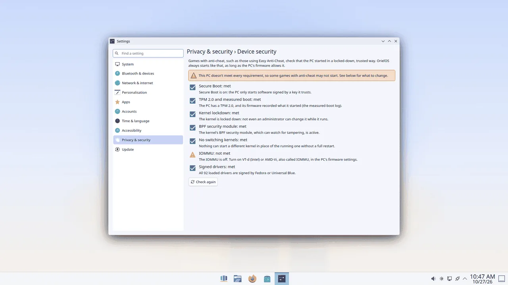

# Games with anti-cheat

Many online games use anti-cheat software, such as Easy Anti-Cheat, to stop players from cheating. On Linux, Easy Anti-Cheat asks for a PC that starts in a locked-down, trusted way. OrielOS always starts in that way. There's nothing to turn on, and there's no separate "gaming mode" to choose when the PC starts.

## What that means

Every time OrielOS starts:

- **Secure Boot is on.** Only software signed by Fedora or Universal Blue starts, including every driver. See [Secure Boot and your drivers](secure-boot.md) for the one-time step that lets the NVIDIA driver and the other Universal Blue drivers load.
- **The system is locked down.** Not even an administrator can change the running system's core (the kernel) while it runs, for example by loading an unsigned driver.
- **Devices are kept apart.** The PC's memory protection for devices (the IOMMU) is on, so a device can only reach the memory it has been given.
- **Security monitoring is available.** The kernel's built-in way to watch for tampering (the BPF security module) is on.
- **The running system can't be swapped out.** Nothing can start a different system in place of the running one without a full restart.

## Checking your PC

OrielOS can only start this way if the PC's firmware lets it: Secure Boot, the TPM and the IOMMU are switched on or off there. To see whether your PC meets every requirement, open **Settings > Privacy & security > Device security**. Anything not met comes with what to change.

## Why there's no Hibernate

Hibernate saves everything in memory to the disk and switches the PC off. Because the system is locked down, it can't safely read that saved memory back in, so OrielOS doesn't offer Hibernate.

**Sleep** works as usual: choose **Sleep** from the Start menu's power options, or close the lid of a laptop. The PC wakes up where you left off.

## If a game still won't start

Some games choose not to allow Linux at all, whatever the system does. Check whether the game supports Linux or the Steam Deck before you buy it.

Licence: CC BY-SA 4.0 (see `LICENSE` in this folder).
