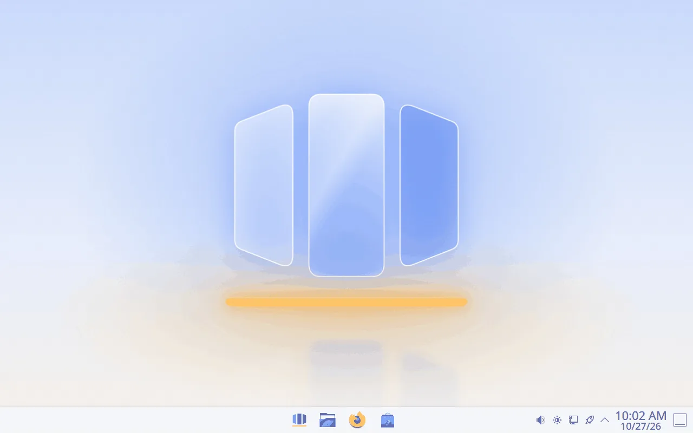
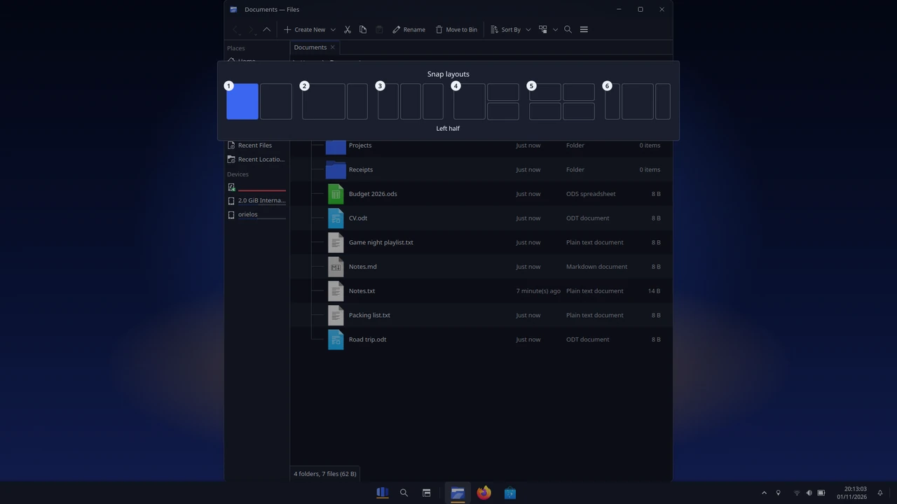
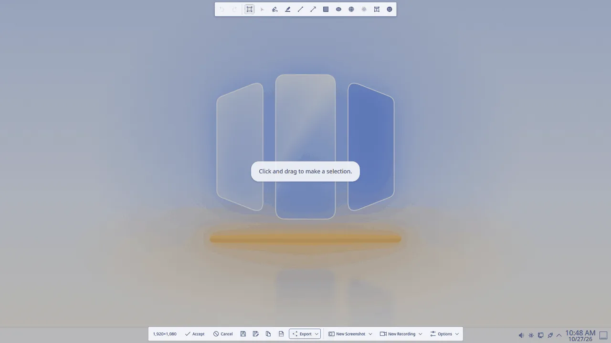
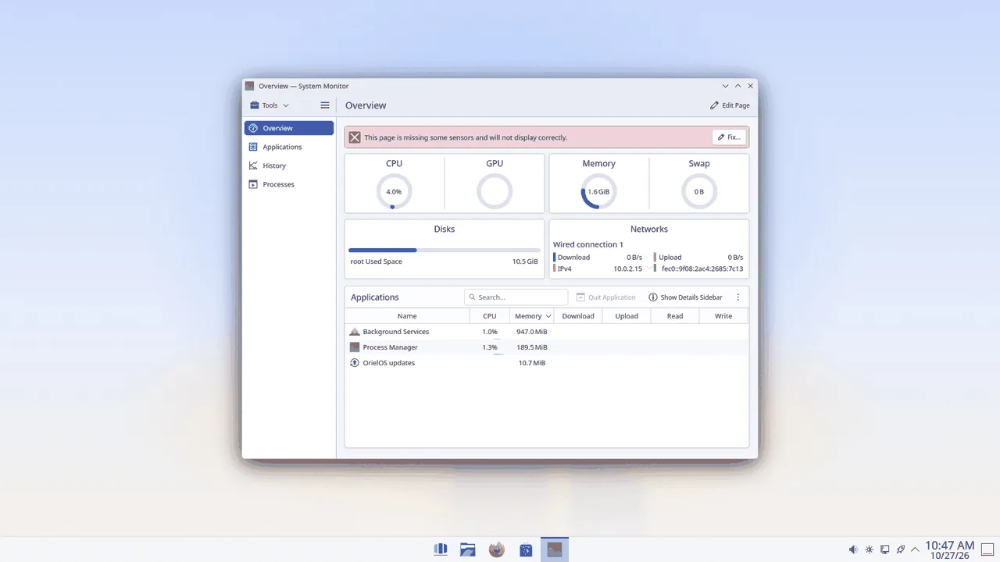
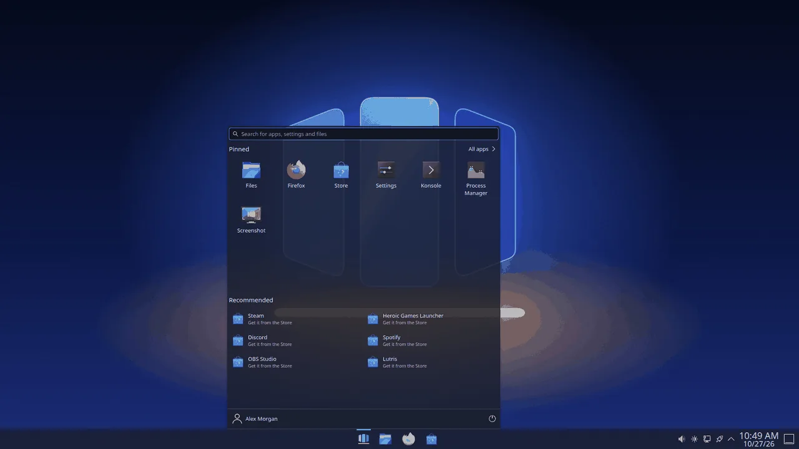

# The desktop

The OrielOS desktop works the way you expect if you're coming from Windows: a taskbar along the bottom, Start in the middle of it, and the system tray and clock on the right.

## The taskbar

- **Start** is the first button in the middle. Click it, or press the Windows key. See [Using Start](start-menu.md).
- **Search** and **Task View** come next. Search opens Start ready to type; Task View shows all your windows and desktops, as Windows + Tab does. Resting the pointer on Task View shows your desktops, to click one or **New desktop**.
- **Your pinned apps** sit beside it: Files, Firefox and the Store to begin with. Click one to open it, or to switch to it if it's already open. Apps you open that aren't pinned appear next to them while they run. Point at a running app to see its windows; click an app with several windows to choose one from their thumbnails, and rest on a thumbnail to see just that window. Windows + 1 to 9 opens or switches to the app in that place.
- **To pin or unpin an app**, right-click it on the taskbar and choose **Pin to taskbar** or **Unpin from taskbar**. You can also pin apps from Start.
- **Right-click an empty part of the taskbar** for **Process Manager** and **Taskbar settings**.
- **Settings > Personalisation > Taskbar** moves the taskbar's apps to the left, hides the taskbar until you point at the bottom of the screen, shows each window as its own button with its title (**Combine taskbar buttons: Never**), shows the taskbar on every display, each with that display's windows, peeks at the desktop while you point at the far corner, turns the Search and Task View buttons off and shows seconds in the clock.

## The right of the taskbar

- **The arrow** shows the icons of apps running in the background, such as Discord or Steam, and the OrielOS updates icon when an update is ready (see [Updates and going back](updates.md)). Windows + B opens it.
- **Quick Settings** is the button with the network, volume and battery icons. Click it, or press Windows + A, for tiles that turn Wi-Fi, Bluetooth, airplane mode, energy saver and night light on and off, sliders for brightness and volume, and the battery's charge and time left. What's playing shows on a card above it, with play, pause and skip. The arrow on the Wi-Fi tile lists the networks in range: choose one to connect, typing its password in place the first time. The arrow on the Bluetooth tile lists your paired devices to connect or disconnect, with their battery, and Add device. The headphones button next to the volume slider switches between sound outputs and has a volume slider for each app playing sound. The pencil at the bottom edits the tiles: unpin one with the button on its corner, drag tiles into a new order, add unpinned ones back with Add (among them Mobile hotspot, Project, which opens the display choices of Windows + P, and Keyboard layout), then choose Done. More than six tiles go onto further pages, turned with the dots beneath them. Scrolling over the button changes the volume.
- **The clock and the bell.** The bell shows how many new notifications you have. Click either, or press Windows + N, for your notifications, newest first, with an app's notifications grouped under its name (the cross beside the name clears them), and the month's calendar beneath them; click the date to fold the calendar away. The bell at the top turns Do not disturb on and off, **Clear all** clears the list, and the focus row under the calendar turns on Do not disturb for a focus session: set its length with − and + (5 minutes to 4 hours; 30 minutes at first), choose **Start**, and the row counts down the time left until it ends or you choose **Stop**. While Do not disturb or a focus session is on, apps on the taskbar don't show badges or progress. After an update, Do not disturb is on for the first hour after you sign in, as on Windows; the bell turns it off sooner.
- **The thin strip at the far right** shows the desktop. Click it again, or press Windows + D, to bring your windows back.

Notifications pop up at the bottom right, above the clock, and stay in the list until you clear them.

## The desktop

The **Bin** sits at the top left of the desktop, and shows when it has something in it. Double-click it to see what you deleted. Files you save to the desktop line up in columns beneath it.

Right-click the desktop for **View** (icon size and arrangement), **Sort by**, **Refresh**, **New** (a folder or a document), **Display settings**, **Personalise** (the wallpaper and colours) and **Open in Terminal**. **Show more options** has the rest, such as emptying the Bin and adding widgets.

## Touchpads

A touchpad clicks when you tap it, and two fingers scroll the page the way Windows does: move them up to go down the page. A two-finger tap is a right-click. Four fingers swiping up show all your windows, and swiping left or right switches desktops. Change any of this in **Settings > Bluetooth & devices > Touchpad**.

## Windows

- **Snap a window** to one side with Windows + Left or Right arrow, or drag it to the edge of the screen.
- **Snap layouts:** rest the pointer on a window's maximise button, or press Windows + Z, to choose a half, a third or a quarter of the screen for it. Dragging a window to the top of the screen drops the same layouts down as a bar: let go over an area to snap the window there, or at the very top edge to maximise it.
- **Snap assist:** after a window snaps to one half, the other half shows your other windows; click one to put it beside the first, or press Escape to leave the half empty.
- **Settings > System > Multitasking** turns each of these on or off: snapping by dragging, the snap layouts on the maximise button and snap assist. It also chooses whether Alt + Tab shows the windows of every desktop or only of the one you're using.

  

- **See every window** with Windows + Tab, and switch between them with Alt + Tab: hold Alt and press Tab to move along the windows, and let go to switch. While it shows, Delete closes the selected window. Ctrl + Alt + Tab shows the same windows and keeps them on screen after you let go, until you choose one with the arrow keys and Enter, or click it; Escape closes it.
- **Window buttons:** minimise, maximise and close are at the top right of every window. Close turns red when you point at it.
- **A second screen or projector:** press Windows + P to choose **PC screen only**, **Duplicate** (the same picture on both), **Extend** (one desktop across both) or **Second screen only**. **Display settings** at the bottom arranges the screens in more detail.

[Keyboard shortcuts](keyboard-shortcuts.md) lists them all, with how snap layouts work from the keyboard.

## Files

**Files** is where your documents, downloads, pictures and drives are. Open it from the taskbar or with Windows + E. Along the top are back, forward, up and refresh, then New, Cut, Copy, Paste, Rename, Delete, Sort, View and search, with the address bar beneath them. Folders open in the Details view, with each item's name, date modified, type and size; choose another view under **View**. Your folders (Documents, Downloads, Pictures, Music and Videos) are in the panel on the left, with USB sticks and other drives below them when they're plugged in. Right-click a file for **Send to** (a shortcut on the desktop, a copy in Documents, or a compressed folder); Ctrl + Shift + C copies its path, and Alt + P shows its preview and details at the right. Double-clicking a disc image (.iso) opens it as a drive; eject it from the drives in the panel.

## Taking a screenshot

- **Windows + Shift + S** or **PrtSc:** drag to choose part of the screen. The screenshot is saved to **Pictures > Screenshots** and copied, ready to paste; Screenshot then shows it, ready to draw on.
- **Windows + PrtSc:** saves the whole screen to **Pictures > Screenshots**.
- **Alt + PrtSc:** captures the window you're using.

Screenshot is also in Start, under that name.

## Process Manager

When an app stops responding, press Ctrl + Shift + Esc to open **Process Manager**. It shows what's running and how much of the processor, memory, disk and network each app uses. Select the app and choose **End process** to close it.

When the computer is nearly out of memory, a notification says **Your computer is low on memory** and offers **Open Process Manager**, so you can see which apps use the most and close some.

## Light and dark

OrielOS has a light and a dark look. Switch between them in **Settings > Personalisation > Themes**, and choose the colour of highlights in **Accent colour** on the same page's list. Each look has its own wallpaper: Daybreak for light and Nightfall for dark.

## Locking and signing out

Press Windows + L to lock the screen. While it is locked, the bottom right of the screen shows the apps that sent you notifications since you locked it, with how many from each, and the network and battery; above the bottom, the next item in your calendar within the week. The screen turns off after a minute without input. After you sign in, a Welcome screen shows your picture and name until the desktop is ready. Your account and the power button at the bottom of Start sign you out, lock, put the PC to sleep, restart it or shut it down.

After five wrong passwords in a row, the lock screen and the sign-in screen ask you to type the characters they show, such as A1B2C3, and then wait 30 seconds before taking a password again; each time after that, the wait doubles, up to 15 minutes.

**Dynamic lock** locks the computer about a minute after your phone goes out of Bluetooth range. Pair the phone in Settings → Bluetooth & devices, then choose it under Settings → Accounts → Sign-in options. It locks only after it has seen the phone connected, so a phone that is switched off doesn't lock you out.

A short startup sound plays when the sign-in screen first appears after the computer starts, not after signing out.

Licence: CC BY-SA 4.0 (see `LICENSE` in this folder).
