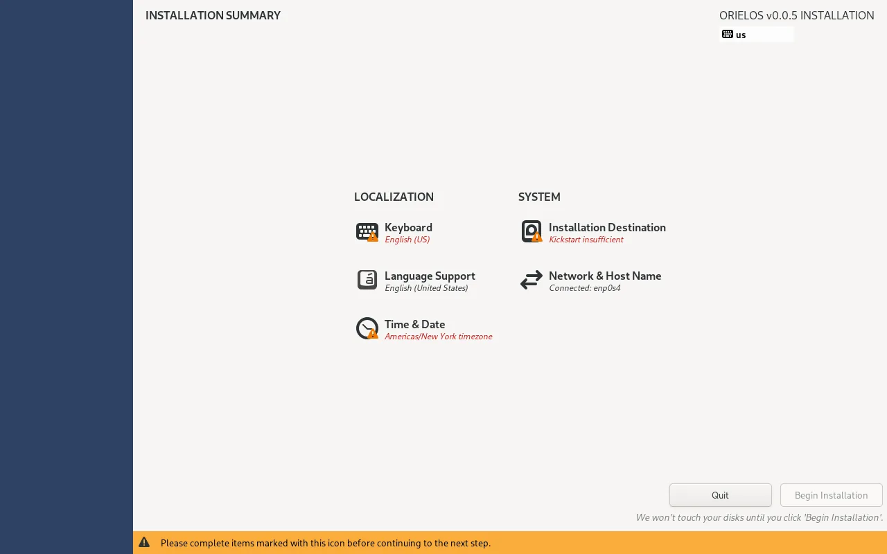
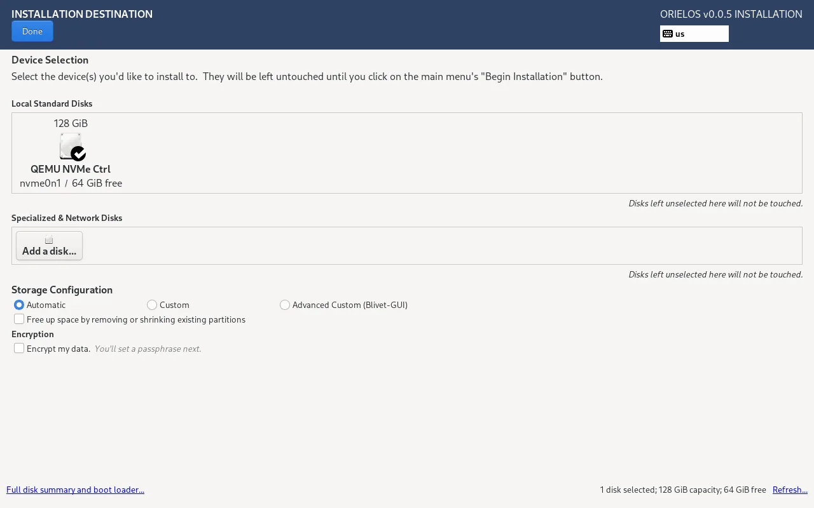
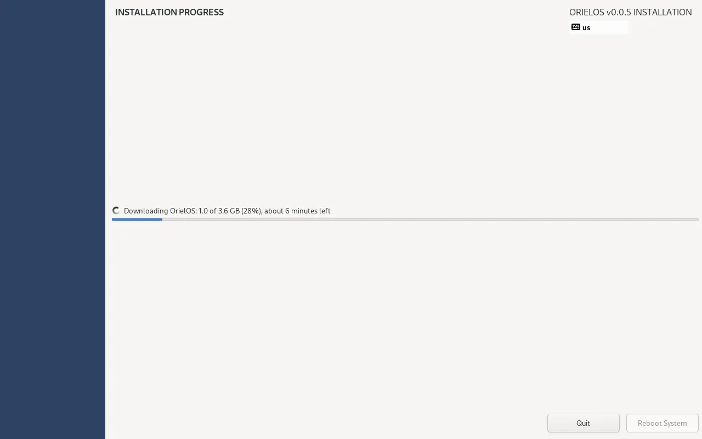
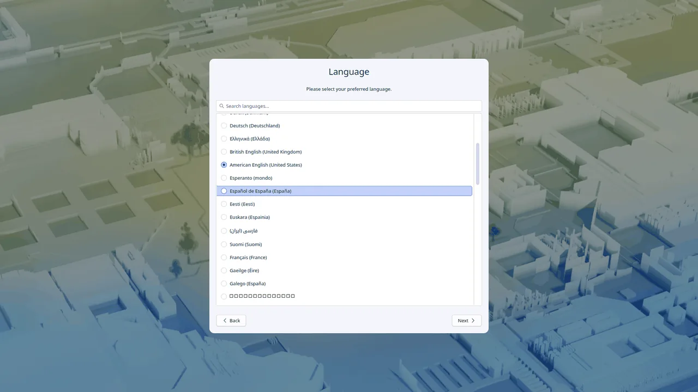

# Install OrielOS

This guide takes you from download to desktop: making the USB stick, making room next to Windows (if you want to keep it), the installer's screens and the first start. It takes about half an hour, most of it waiting for the download.

## What you need

- A PC with NVIDIA RTX graphics, 20-series or newer. OrielOS is made for desktop PCs; [Status](status.md#hardware-verified) lists the PCs it has been checked on. PCs with only AMD or Intel graphics aren't supported yet.
- A 64-bit Intel or AMD processor, UEFI firmware and Secure Boot (any PC that runs Windows 11 has these).
- At least 60 GB of free space for OrielOS: a whole drive, or unused space next to Windows.
- A USB stick of 2 GB or more. Writing the installer to it erases everything on it.
- An internet connection during the install: Wi-Fi or a cable. The installer downloads OrielOS as it installs, so you always get the current version.

## Before you start

- **Back up** anything you can't lose. Installing changes your drive's partitions.
- **If you keep Windows:**
  - Check **Settings → Privacy & security → Device encryption** (or **BitLocker** on Windows Pro). If it's on, save your recovery key first, from <https://aka.ms/myrecoverykey> or the BitLocker settings. Windows can ask for it once after another system is installed.
  - Turn off **Fast Startup**: Control Panel → Power Options → "Choose what the power buttons do" → untick "Turn on fast startup".
  - Make room for OrielOS in Windows itself: right-click Start → **Disk Management** → right-click **C:** → **Shrink Volume**, and shrink it by at least 61440 MB (60 GB). Leave the new space as **Unallocated**; don't create a volume in it.

## 1. Download

Download **OrielOS.iso** from the [latest release](https://github.com/OrielOS/OrielOS/releases/latest), with **SHA256SUMS** next to it. To check the download, compare the ISO's SHA-256 with the line in SHA256SUMS (it's also shown on [orielos.org/download](https://orielos.org/download/)): in Windows PowerShell, `Get-FileHash OrielOS.iso`; on macOS, `shasum -a 256 OrielOS.iso`; on Linux, `sha256sum -c SHA256SUMS --ignore-missing`. If they don't match, download the ISO again.

## 2. Make the USB stick

Write the ISO to the stick with [balenaEtcher](https://etcher.balena.io/) or [Fedora Media Writer](https://fedoraproject.org/workstation/download), which work on Windows, macOS and Linux, or with [Rufus](https://rufus.ie/) on Windows (choose **DD image mode** if it asks). In Fedora Media Writer, choose **Select .iso file**; in balenaEtcher, **Flash from file**; then pick the stick and write. Windows may then say it can't read the stick; that's normal for an installer stick, so don't format it.

## 3. Start from the stick

Plug in the stick and restart. Open your PC's boot menu as it starts (usually **F11**, **F12**, **F8** or **Esc**, shown briefly on the maker's logo) and choose the USB stick. Leave Secure Boot on.

If the stick isn't offered, open the firmware settings instead (usually **Del** or **F2** as the PC starts) and check two things: **Secure Boot** is on, with the standard or Microsoft keys ("Windows UEFI mode" on some boards), and booting from USB is allowed. Turn off **CSM** or **Legacy boot** if it's on; OrielOS needs UEFI.

Choose **Install OrielOS** in the menu that appears. The menu and the installer show the version of OrielOS that was current when the ISO was made, such as v0.0.7; the installer always downloads the newest stable version.

## 4. The installer

1. Choose your **language** and select **Continue**.
2. On the summary screen:

   

   - **Network & Host Name**: connect to Wi-Fi if you're not on a cable.
   - **Keyboard** and **Time & Date**: open each, check it, and select **Done**.
   - **Installation Destination**: select your drive.
     - **Next to Windows**: keep **Automatic** and leave "Free up space" unticked; the installer uses only the unallocated space you made. It may warn that the EFI system partition is under 500 MiB: that's Windows' boot partition, which OrielOS shares, and the warning is harmless. If Windows' drive is encrypted with BitLocker, it also warns that Windows may ask for the recovery key: have the key ready, as above.
     - **On the whole drive**: tick "Free up space by removing or shrinking existing partitions", select **Done**, then **Delete all** and **Reclaim space**. Everything on that drive is erased.

   
3. Select **Begin Installation**. The installer downloads OrielOS and shows how much is left and roughly how long it will take, then installs it.

   

4. When it's done, select **Reboot System** and remove the USB stick.

The installer doesn't ask for an account: OrielOS asks for it when it first starts.

## 5. The first start

- **On a PC with Windows**, a menu lists OrielOS and Windows for five seconds at every start; OrielOS starts if you don't choose.
- During the very first start, a red line about **"Load Kernel Modules"** may flash past. It's expected: your PC doesn't trust OrielOS's extra drivers yet (the next step fixes that).
- **The first-run setup** asks for your language, keyboard layout, network, time zone and power settings, then creates your account.

  

- A notification, **Finish setting up your graphics driver**, asks you to restart once and confirm a key on a blue screen, with the password `orielos`. This lets the NVIDIA driver and other drivers load. [Secure Boot and your drivers](secure-boot.md) shows each step. If you see no blue screen, your PC already trusts the key (for example after installing OrielOS before).

## After installing

- **Updates arrive by themselves** and apply when you restart. You can always go back to the previous version: see [Updates and going back](updates.md).
- **Your PC is on the stable channel**, which gets versions that have been tested on real PCs. If you'd like new versions sooner, switch to **testing** in Settings → Update → Update channel; something may break now and then, and you can always go back.
- **Get apps and games from the Store**: see [Installing apps](apps.md) and [Games and controllers](games-and-controllers.md).

## If something goes wrong

- **The PC starts Windows, not the stick**: open the boot menu again, or put USB first in the firmware's boot order.
- **The installer's screen freezes before it starts**: restart and start from the stick again.
- **Reinstalling next to Windows**: in Installation Destination, tick "Free up space", select **Done**, and delete only the earlier OrielOS's two partitions (an ext4 one of about 2 GiB and a btrfs one named `orielos`), never the EFI System Partition or Windows' ntfs partitions. Then select **Reclaim space**.
- **Ask for help** in the [Q&A](https://github.com/OrielOS/OrielOS/discussions/categories/q-a) category of GitHub Discussions, or on [the official OrielOS Discord server](https://discord.gg/RnpZYaKbHA), with a photo of the screen.
