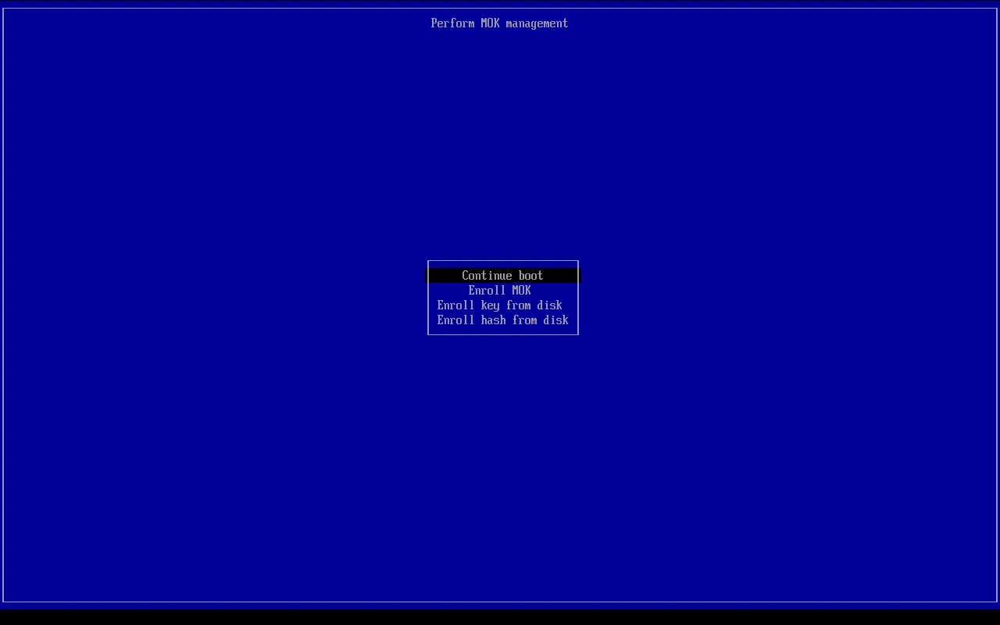
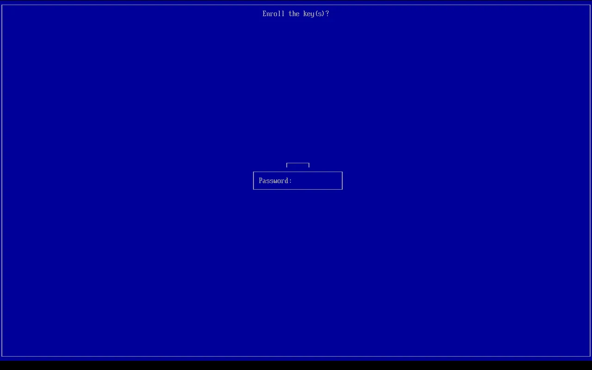

# Secure Boot and your drivers

OrielOS starts with Secure Boot turned on, as Windows 11 does. Secure Boot only lets software start that carries a signature the PC trusts. After you install OrielOS, there's one extra step, once, so that the PC trusts OrielOS's drivers too.

## Why the step is needed

OrielOS's system is signed by Fedora, and every PC with Secure Boot trusts it already. Some drivers come from Universal Blue and are signed with Universal Blue's key instead:

- the NVIDIA graphics driver;
- the Xbox wireless adapter and controller drivers (xone and xpadneo);
- the Razer device driver (OpenRazer);
- the virtual camera driver (v4l2loopback).

Your PC doesn't know Universal Blue's key yet, so it refuses these drivers until you tell it to trust the key. You do that once, on a blue screen that appears when the PC starts. OrielOS only ever asks your PC to trust Universal Blue's key, and never adds a key of its own.

## What you'll see

When you first start OrielOS, it gets the key ready for your PC to confirm, and a notification appears on the desktop: **Finish setting up your graphics driver**. Choose **Restart now**, or just restart when it suits you.

During the next restart, before OrielOS starts, a blue screen appears with the title **Shim UEFI key management**. It waits only 10 seconds, so be ready:

1. Press any key.
2. Choose **Enroll MOK** and press Enter. (Use the arrow keys to move between choices.)

   

3. Choose **Continue** and press Enter.
4. Choose **Yes** and press Enter.
5. Type the password `orielos` and press Enter. Nothing appears on screen as you type.

   

6. Choose **Reboot** and press Enter.

The PC restarts, OrielOS starts, and the drivers load from then on. You won't see the blue screen again.

## If you miss it

If you don't press a key in time, or choose **Continue boot**, OrielOS starts normally, but the NVIDIA graphics driver and the other drivers above don't load. OrielOS asks your PC again, so the blue screen appears at the next restart and you can do it then.

## How to check

Open **Konsole** and run:

```sh
mokutil --list-enrolled | grep 'ublue kernel'
```

If a line with `CN=ublue kernel` appears, the key is trusted and the drivers load. If nothing appears, restart and follow the steps above.

## If your PC needs a firmware update

Newer versions of the software that starts OrielOS are signed by Microsoft's 2023 certificate for UEFI. Microsoft's older 2011 certificate expired in June 2026, so a PC that only knows the old one may stop starting OrielOS with Secure Boot after a future update.

If your PC's firmware doesn't have the 2023 certificate, OrielOS shows a notification: **Your PC needs a firmware update**. Go to the support website of your PC or motherboard manufacturer, find your model, and install the latest firmware (also called BIOS or UEFI) update. Windows Update may also install it if Windows is on the same PC.

Licence: CC BY-SA 4.0 (see `LICENSE` in this folder).
