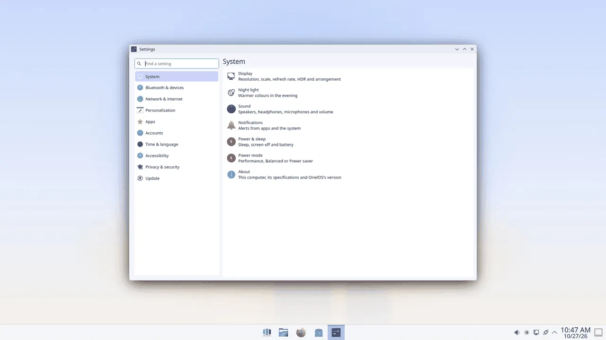

# Settings

Settings is where you change how OrielOS works. Open it with Windows + I, or choose **Settings** in Start. If it's already open, Windows + I brings it to the front.

Settings opens on **Home**: the settings you used most recently, then recommended ones such as Display, Sound, Network, Bluetooth, Background and Update. Your picture and name are at the top left; click them for Your info.

## Finding a setting

The categories on the left come in the order you know from Windows (in a narrow window they hide behind the menu button beside the page's title):

- **System**: Display, Night light, Sound, Notifications, Power & sleep, Power mode, Multitasking (snapping windows and Alt + Tab), NVIDIA settings (on computers with an NVIDIA graphics card; it opens NVIDIA's own app) and About.
- **Bluetooth & devices**: Bluetooth, Mouse, Touchpad, Keyboard, Printers, Game controllers and Accessory apps.
- **Network & internet**: Wi-Fi, Ethernet, VPN and hotspot, and Proxy.
- **Personalisation**: Background, Themes (including dark mode), Accent colour (with Show accent colour on Start and taskbar, and Transparency effects, which makes the taskbar and pop-ups solid when off), Lock screen, Start and Taskbar.
- **Apps**: Default apps and Startup.
- **Accounts**: Your info, with your password and other accounts, and Sign-in options: a PIN, fingerprints, dynamic lock, and the sign-in screen's settings.
- **Time & language**: Date & time, and Language & region.
- **Accessibility**: Screen reader and keyboard (sticky keys, slow keys, mouse keys, a tone for Caps Lock and Num Lock under Modifier keys, and the visual bell), Zoom and colour filters, Mouse pointer (a white or black pointer, from 24 to 96 pixels) and On-screen keyboard.
- **Privacy & security**: Device security, Firewall, App permissions, Activity history, and Diagnostics & feedback.
- **Update**: OrielOS updates (see [Updates](updates.md)).
- **More settings**: everything else, such as Fonts, so every setting is in one place.

Choose a category to see its pages, then a page to open it. To search instead, type in **Find a setting** at the top (or press Ctrl+F). Search knows the names of the pages and the words people use for them, including Windows' own, such as "wifi", "default apps", "resolution" or "windows update". Press Enter to open the best match.

You can also search from Start: type what you're looking for, such as "wifi", "dark mode" or "nvidia", and the setting opens in Settings. Anything that asks for System Settings, such as a "Configure…" button, opens Settings instead.

Buttons and switches that ask for an administrator's password are marked with a key icon.

OrielOS has four high-contrast colour schemes for when text needs to stand out as much as possible: **OrielOS High Contrast Black**, **Ocean**, **Evening** and **Paper**. Left Alt + Left Shift + Print Screen turns Black on, or goes back to the scheme you had; choose another under **More settings > Colours**, and the shortcut then turns that one on and off instead.

## Applying changes

Some pages change things as soon as you choose them. Others show **Apply** and **Reset** at the bottom: Apply keeps your changes, and Reset puts back the settings you had. **Defaults** puts back OrielOS's own settings. If you leave a page, or close Settings, with changes you haven't applied, Settings asks whether to apply or discard them.

Some changes, such as the date and time, ask for an administrator's password. The prompt dims the rest of the screen and asks "Do you want to allow this app to make changes to your device?", with the app's name and its publisher: OrielOS, or the maker of the service that asks, for anything that comes with OrielOS, and **Publisher: Unknown** in red for a program from anywhere else. **Show more details** shows the program's location and the command it runs. Type the password (or your PIN) and choose **Yes**, or choose **No**.

## Power mode

**System > Power mode** chooses between **Performance**, **Balanced** and **Power saver**, the same choice as in the battery and power icon in the system tray. OrielOS starts in Performance, on mains power and on battery; whichever mode you choose is kept, also after restarts and updates. If the computer holds Performance back, for example because it's too hot, the page says so.

## Start and the taskbar

**Personalisation > Start** chooses what Start shows under Recommended: turn off **Show recently added apps** or **Show recently opened files** and Start stops listing them straight away.

**Personalisation > Taskbar** sets **Taskbar alignment**, Centre or Left, and **Automatically hide the taskbar**, which hides it until you move the pointer to the bottom of the screen. Changes apply at once. If you've rearranged the taskbar's widgets yourself, alignment can't be set here any more; the page says so.

## Storage

**System > Storage** shows how much of the disk is used and what fills it: installed apps, temporary files, the Bin, your Documents, Pictures, Videos, Music, Downloads and Desktop folders, and **System and other** for the rest. Click one to open it in Files (installed apps open the Apps page). **Clean up now** empties the Bin and deletes thumbnails and the temporary files that apps haven't used for 30 days, after asking.

**Storage Sense**, off until you turn it on, frees space by itself once a day: it deletes temporary files that apps haven't used for 30 days and empties Bin items that have been there longer than you choose (1, 14, 30 or 60 days, or never). **Run Storage Sense now** runs it straight away.

## Do not disturb at set times

**System > Do not disturb** turns Do not disturb on by itself during the hours you choose: **From** and **To**, and whether it **Repeats** daily, on weekdays or at weekends. Hours that start in the evening and end in the morning count from the day they start. Notifications still go to the notification centre while it's on.

## Fonts

**Personalisation > Fonts** lists the installed fonts, each with a sample written in it, and a search box. To install fonts for your account, drag TrueType or OpenType files (`.ttf`, `.otf`, `.ttc`) onto the page, or click **Browse and install fonts**. Apps that are already open show new fonts the next time they start.

## Accent colour

**Personalisation > Accent colour** sets the colour of highlights, selected items and focus rings. Choose one of the colours and it applies straight away; **Use the theme's colour** goes back to the colour your theme came with. Light and dark mode are on the Themes page, and your accent stays when you switch between them.

## Accessory apps

Gaming mice, keyboards and RGB lighting are set up with apps from the Store: Solaar for Logitech mice, keyboards and their receivers, Piper for gaming mice, and OpenRGB for lighting. **Bluetooth & devices > Accessory apps** lists them. If one is installed, **Open** starts it; if not, **Get it from the Store** opens its page in the Store, where you choose whether to install it. OrielOS already has the system parts these apps need to reach your devices.

## Device security

**Privacy & security > Device security** checks that this PC meets what games with anti-cheat require: Secure Boot, a TPM 2.0 that recorded the start-up, a locked-down kernel, the kernel's BPF security module, no switching to another kernel while running, the IOMMU, and drivers signed only by Fedora or Universal Blue. Each one shows as met or not met, and anything not met says what to change, usually in the PC's firmware settings. **Check again** runs the checks once more. See [Games with anti-cheat](anti-cheat.md) for what each one means.

## From the update icon

Clicking the **OrielOS updates** icon in the system tray opens Settings on the Update page.
