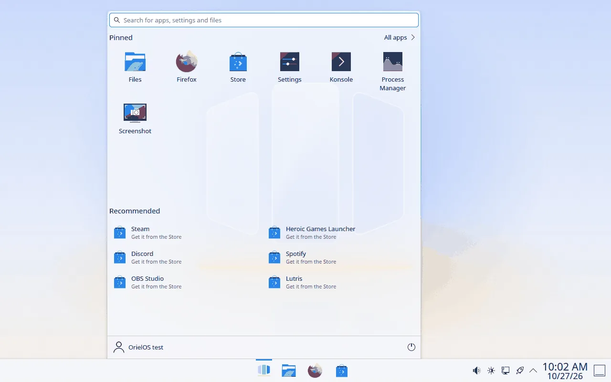

# Using Start

Press the Windows key (Win), or click the Start button in the middle of the taskbar, to open Start. Press it again, or Escape, to close it.

## Search

Start typing as soon as Start opens. The results list apps, settings, files, apps in the Store, and quick calculations such as `12*7`, grouped by kind. Settings open in [Settings](settings.md), and know Windows' words for them, such as "wifi", "default apps" or "windows update". Typing never opens anything by itself: press Enter to open the highlighted result (the first one, unless you moved with the Up and Down arrow keys), or click a result.

## Pinned apps

Your pinned apps fill the top of Start. To change them, right-click an app anywhere in Start, or select it and press the Menu key or Shift+F10:

- **Pin to Start** adds it to the end of your pinned apps.
- **Unpin from Start** removes it.
- **Move to front** moves a pinned app to the first place.
- **Pin to taskbar** adds it to the apps in the middle of the taskbar, and **Pin to desktop** puts its icon on the desktop.

Your pinned apps are saved with your account, so they stay the same after a restart or an update. An app you pinned that isn't installed yet appears as soon as it is.

**All apps**, next to the Pinned heading, lists every installed app in alphabetical order. **Back** returns to your pinned apps.

## Recommended

Recommended shows apps you installed in the last three days, then files you opened recently. Click one to open it. To leave either out, go to **Settings > Personalisation > Start**.

Until you hide them, Recommended also suggests apps to get started with: Steam, Discord, Spotify and OBS Studio. Each one says "Get it from the Store", and clicking it opens its page in the Store, where you choose whether to install it. An app leaves the list once it's installed. To hide the suggestions, right-click one (or press the Menu key on it) and choose **Hide these suggestions**.

## Your account and the power button

At the bottom of Start:

- **Your name** opens Account settings, and lets you Lock the screen, Switch user or Sign out.
- **The power button** offers Sleep, Restart and Shut down. There is no Hibernate: see [Games with anti-cheat](anti-cheat.md) for why.

## Using the keyboard

- **Tab** and **Shift+Tab** move between the search field, All apps, your pinned apps, Recommended, your account and the power button.
- **The arrow keys** move within your pinned apps and lists.
- **Enter** or **Space** opens the selected item.
- **Escape** first clears the search, then goes back from All apps, then closes Start.
